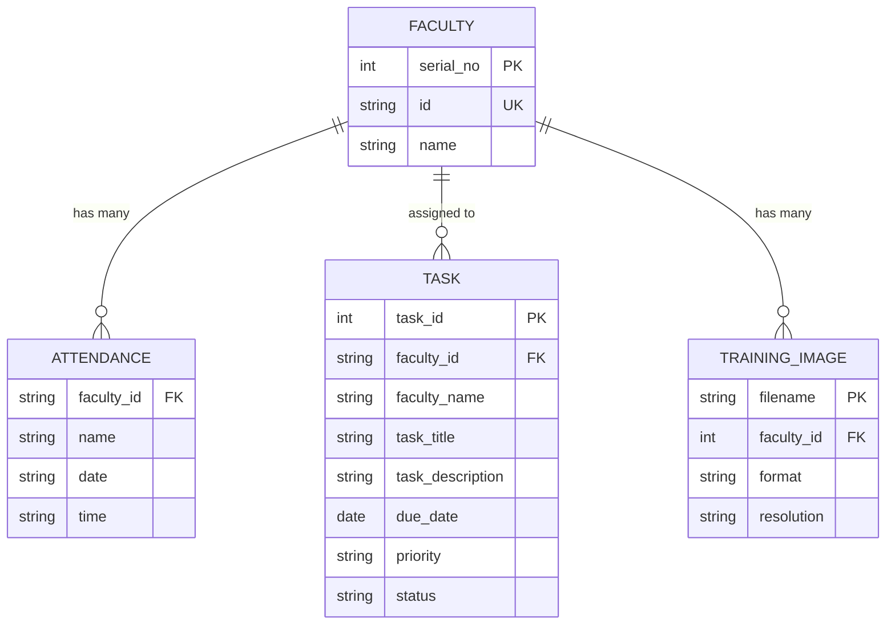

# Data Dictionary - GreatA Greeting Automated System

## Overview
This data dictionary documents all data elements, structures, and relationships within the GreatA Greeting Automated System. The system uses CSV files for data storage and manages faculty information, attendance records, tasks, and system configurations.

## Data Storage Structure

### File Organization
```
GreatA-Greeting-Automated-System/
├── FacultyDetails/
│   └── FacultyDetails.csv          # Faculty master data
├── Attendance/
│   └── Attendance_DD-MM-YYYY.csv   # Daily attendance records
├── Tasks/
│   └── Tasks.csv                   # Task management data
├── TrainingImage/                  # Face training images
├── TrainingImageLabel/
│   ├── Trainner.yml               # Trained face recognition model
│   └── psd.txt                    # Admin password storage
└── Exported_Attendance_*.csv      # Exported attendance reports
```

## Data Elements

### 1. Faculty Details (FacultyDetails.csv)

| Field Name | Data Type | Length | Description | Example | Constraints |
|------------|-----------|--------|-------------|---------|-------------|
| SERIAL_NO | Integer | - | Auto-incrementing serial number | 1, 2, 3 | Primary Key, Unique |
| Unnamed_1 | String | - | Empty column (CSV formatting) | "" | Optional |
| ID | String | 20 | Unique faculty identifier | "2021-430", "312-21321" | Required, Unique |
| Unnamed_3 | String | - | Empty column (CSV formatting) | "" | Optional |
| NAME | String | 100 | Full name of faculty member | "Michael Paul Sebando" | Required |

**Sample Data:**
```csv
SERIAL NO.,Unnamed: 1,ID,Unnamed: 3,NAME
1,,312-21321,,Ferg June S Quiñanola
```

### 2. Daily Attendance Records (Attendance_DD-MM-YYYY.csv)

| Field Name | Data Type | Length | Description | Example | Constraints |
|------------|-----------|--------|-------------|---------|-------------|
| Id | String | 20 | Faculty ID from FacultyDetails | "2021-430" | Foreign Key |
| Unnamed_1 | String | - | Empty column separator | "" | Optional |
| Name | String | 100 | Faculty name | "Michael Paul Sebando" | Required |
| Unnamed_3 | String | - | Empty column separator | "" | Optional |
| Date | String | 10 | Attendance date (DD-MM-YYYY) | "13-10-2025" | Required |
| Unnamed_5 | String | - | Empty column separator | "" | Optional |
| Time | String | 8 | Attendance time (HH:MM:SS) | "01:01:03" | Required |

**Sample Data:**
```csv
Id,,Name,,Date,,Time
'2021-430',,Michael Paul Sebando,,13-10-2025,,01:01:03
'2022-02800',,FERG JUNE S QUIÑANOLA,,13-10-2025,,07:14:08
```

### 3. Task Management (Tasks.csv)

| Field Name | Data Type | Length | Description | Example | Constraints |
|------------|-----------|--------|-------------|---------|-------------|
| TASK_ID | Integer | - | Unique task identifier | 1, 2, 3 | Primary Key, Auto-increment |
| FACULTY_ID | String | 20 | Faculty ID assigned to task | "2021-430" | Foreign Key |
| FACULTY_NAME | String | 100 | Name of assigned faculty | "Michael Paul Sebando" | Required |
| TASK_TITLE | String | 200 | Brief task description | "Sleep Mode" | Required |
| TASK_DESCRIPTION | String | 500 | Detailed task description | "You need to Sleep Mode." | Required |
| DUE_DATE | Date | 10 | Task deadline (YYYY-MM-DD) | "2025-10-13" | Required |
| PRIORITY | Enum | 10 | Task priority level | "Medium", "Low", "High", "Urgent" | Required |
| STATUS | Enum | 15 | Task completion status | "Pending", "In Progress", "Completed", "Cancelled" | Required |

**Sample Data:**
```csv
TASK_ID,FACULTY_ID,FACULTY_NAME,TASK_TITLE,TASK_DESCRIPTION,DUE_DATE,PRIORITY,STATUS
1,2021-430,Michael Paul Sebando,Sleep Mode,You need to Sleep Mode.,2025-10-13,Medium,Pending
```

### 4. System Configuration Files

#### Admin Password (psd.txt)
| Field Name | Data Type | Length | Description | Example | Constraints |
|------------|-----------|--------|-------------|---------|-------------|
| password | String | 50 | Encrypted admin password | "admin123" | Required |

#### Trained Model (Trainner.yml)
| Field Name | Data Type | Length | Description | Example | Constraints |
|------------|-----------|--------|-------------|---------|-------------|
| model_data | Binary | Variable | OpenCV LBPH face recognizer model | Binary data | Auto-generated |
| labels | Array | Variable | Faculty ID mappings | [1, 2, 3] | Auto-generated |

### 5. Training Images (TrainingImage/)

| Field Name | Data Type | Length | Description | Example | Constraints |
|------------|-----------|--------|-------------|---------|-------------|
| filename | String | 50 | Image file name | "User.1.1.jpg" | Required |
| format | String | 5 | Image file format | ".jpg" | Required |
| resolution | String | 10 | Image dimensions | "640x480" | Variable |
| faculty_id | Integer | - | Associated faculty ID | 1, 2, 3 | Foreign Key |

**File Naming Convention:**
- Format: `User.{faculty_id}.{image_number}.jpg`
- Example: `User.1.1.jpg`, `User.1.2.jpg`, etc.

## Data Relationships

### Entity Relationship Diagram



### Relationship Descriptions

1. **Faculty → Attendance (1:Many)**
   - One faculty member can have multiple attendance records
   - Faculty ID is the foreign key linking the tables
   - Attendance records are created daily

2. **Faculty → Tasks (1:Many)**
   - One faculty member can be assigned multiple tasks
   - Faculty ID links tasks to faculty members
   - Tasks can have different priorities and statuses

3. **Faculty → Training Images (1:Many)**
   - One faculty member has multiple training images
   - Images are used for face recognition training
   - Typically 100 images per faculty member

## Data Validation Rules

### Faculty Details
- **ID**: Must be unique, alphanumeric, 3-20 characters
- **NAME**: Required, 1-100 characters, no special characters except spaces and hyphens
- **SERIAL_NO**: Auto-generated, sequential integers starting from 1

### Attendance Records
- **ID**: Must exist in FacultyDetails table
- **DATE**: Format DD-MM-YYYY, must be valid date
- **TIME**: Format HH:MM:SS, 24-hour format
- **Duplicate Prevention**: Only one record per faculty per day

### Task Management
- **TASK_ID**: Auto-incrementing integer, unique
- **FACULTY_ID**: Must exist in FacultyDetails table
- **DUE_DATE**: Format YYYY-MM-DD, must be future date
- **PRIORITY**: Must be one of: Low, Medium, High, Urgent
- **STATUS**: Must be one of: Pending, In Progress, Completed, Cancelled

### Training Images
- **Filename**: Must follow naming convention User.{id}.{number}.jpg
- **Format**: Only .jpg files accepted
- **Resolution**: Minimum 100x100 pixels
- **Quantity**: Minimum 50 images per faculty member

## Data Integrity Constraints

### Primary Keys
- FacultyDetails: SERIAL_NO
- Tasks: TASK_ID
- Training Images: filename

### Foreign Keys
- Attendance.faculty_id → FacultyDetails.ID
- Tasks.faculty_id → FacultyDetails.ID
- Training Images.faculty_id → FacultyDetails.ID

### Unique Constraints
- FacultyDetails.ID (unique faculty identifier)
- Attendance (faculty_id + date) - prevents duplicate daily attendance

### Check Constraints
- Attendance.date format: DD-MM-YYYY
- Attendance.time format: HH:MM:SS
- Tasks.due_date format: YYYY-MM-DD
- Tasks.priority: IN ('Low', 'Medium', 'High', 'Urgent')
- Tasks.status: IN ('Pending', 'In Progress', 'Completed', 'Cancelled')

## Data Security

### Access Control
- **Admin Panel**: Password protected (stored in psd.txt)
- **Faculty Data**: Read-only for faculty members
- **Attendance Records**: Append-only for daily records

### Data Backup
- **Automatic**: Daily attendance files created automatically
- **Manual**: Export functionality for attendance reports
- **Training Data**: Images stored in organized folder structure

### Privacy Considerations
- **Face Images**: Stored locally, not transmitted externally
- **Personal Data**: Faculty names and IDs stored in CSV format
- **Attendance Records**: Time-stamped for audit trail

## Data Export Formats

### CSV Export
- **Faculty List**: FacultyDetails.csv format
- **Attendance Report**: Attendance_DD-MM-YYYY.csv format
- **Task Report**: Tasks.csv format

### Report Generation
- **Daily Attendance**: Filtered by specific date
- **Faculty Summary**: All records for specific faculty member
- **Task Status**: Filtered by priority or status
- **System Statistics**: Counts and summaries

## Data Maintenance

### Regular Tasks
- **Daily**: Create new attendance file
- **Weekly**: Export attendance reports
- **Monthly**: Clean up old training images
- **Quarterly**: Backup all data files

### Data Cleanup
- **Orphaned Records**: Remove attendance records for deleted faculty
- **Duplicate Prevention**: Check for duplicate daily attendance
- **File Organization**: Maintain proper folder structure
- **Model Retraining**: Update face recognition model when faculty added/removed
