# Functional Decomposition Diagram (FDD) - GreatA Greeting Automated System

## System Overview
The GreatA Greeting Automated System is a comprehensive faculty attendance management system that uses face recognition, voice interaction, and automated greetings.

## Functional Decomposition Diagram

```mermaid
graph TD
    A[GreatA Greeting Automated System] --> B[User Interface Layer]
    A --> C[Core Business Logic Layer]
    A --> D[Data Management Layer]
    A --> E[External Services Layer]
    
    B --> B1[Main Attendance Interface]
    B --> B2[Admin Panel Interface]
    B --> B3[Voice Assistant Interface]
    
    B1 --> B1a[Take Attendance Module]
    B1 --> B1b[Live Attendance Display]
    B1 --> B1c[Camera Controls]
    
    B2 --> B2a[Dashboard Module]
    B2 --> B2b[Faculty Management]
    B2 --> B2c[Attendance Records]
    B2 --> B2d[Settings Module]
    
    B3 --> B3a[Voice Recognition]
    B3 --> B3b[Text-to-Speech]
    B3 --> B3c[Voice Commands]
    
    C --> C1[Face Recognition Engine]
    C --> C2[Attendance Management]
    C --> C3[Greeting System]
    C --> C4[Authentication System]
    C --> C5[Task Management]
    
    C1 --> C1a[Face Detection]
    C1 --> C1b[Face Training]
    C1 --> C1c[Face Matching]
    C1 --> C1d[Liveness Detection]
    
    C2 --> C2a[Attendance Recording]
    C2 --> C2b[Duplicate Prevention]
    C2 --> C2c[Time Tracking]
    C2 --> C2d[Attendance Reports]
    
    C3 --> C3a[Time-based Greetings]
    C3 --> C3b[Personalized Messages]
    C3 --> C3c[Voice Synthesis]
    
    C4 --> C4a[Admin Authentication]
    C4 --> C4b[Password Management]
    C4 --> C4c[Session Management]
    
    C5 --> C5a[Task Creation]
    C5 --> C5b[Task Assignment]
    C5 --> C5c[Task Tracking]
    C5 --> C5d[Task Reports]
    
    D --> D1[Faculty Database]
    D --> D2[Attendance Database]
    D --> D3[Task Database]
    D --> D4[Training Data Storage]
    D --> D5[Configuration Storage]
    
    D1 --> D1a[Faculty Profiles]
    D1 --> D1b[Faculty Images]
    D1 --> D1c[Faculty Metadata]
    
    D2 --> D2a[Daily Attendance Files]
    D2 --> D2b[Attendance History]
    D2 --> D2c[Export Functions]
    
    D3 --> D3a[Task Definitions]
    D3 --> D3b[Task Status]
    D3 --> D3c[Task Assignments]
    
    D4 --> D4a[Face Training Images]
    D4 --> D4b[Trained Models]
    D4 --> D4c[Model Configuration]
    
    D5 --> D5a[System Settings]
    D5 --> D5b[User Preferences]
    D5 --> D5c[Security Configurations]
    
    E --> E1[Camera Services]
    E --> E2[Audio Services]
    E --> E3[File System Services]
    E --> E4[External APIs]
    
    E1 --> E1a[Webcam Interface]
    E1 --> E1b[Image Capture]
    E1 --> E1c[Video Streaming]
    
    E2 --> E2a[Microphone Interface]
    E2 --> E2b[Speaker Interface]
    E2 --> E2c[Audio Processing]
    
    E3 --> E3a[CSV File Operations]
    E3 --> E3b[Image File Operations]
    E3 --> E3c[Configuration Files]
    
    E4 --> E4a[Weather API]
    E4 --> E4b[Time Services]
    E4 --> E4c[External Recognition APIs]
```

## Key Functional Areas

### 1. User Interface Layer
- **Main Attendance Interface**: Primary interface for daily attendance taking
- **Admin Panel Interface**: Administrative functions for system management
- **Voice Assistant Interface**: Voice-based interaction capabilities

### 2. Core Business Logic Layer
- **Face Recognition Engine**: Core AI functionality for face detection and recognition
- **Attendance Management**: Business logic for attendance tracking and recording
- **Greeting System**: Automated greeting generation and delivery
- **Authentication System**: Security and access control
- **Task Management**: Task assignment and tracking functionality

### 3. Data Management Layer
- **Faculty Database**: Storage and management of faculty information
- **Attendance Database**: Daily attendance records and history
- **Task Database**: Task management data
- **Training Data Storage**: Face recognition training data and models
- **Configuration Storage**: System settings and preferences

### 4. External Services Layer
- **Camera Services**: Webcam integration and image capture
- **Audio Services**: Microphone and speaker integration
- **File System Services**: File operations and data persistence
- **External APIs**: Integration with external services like weather and time

## System Characteristics
- **Real-time Processing**: Live face recognition and attendance recording
- **Multi-modal Interface**: GUI, voice, and camera interaction
- **Data Persistence**: CSV-based data storage with export capabilities
- **Security**: Password-protected admin access
- **Scalability**: Modular design allowing for feature extensions
