# Use Case Diagram - GreatA Greeting Automated System

## System Overview
The GreatA Greeting Automated System serves faculty members and administrators with automated attendance tracking, voice greetings, and task management capabilities.

## Use Case Diagram

```mermaid
graph TB
    %% Actors
    Faculty[👨‍🏫 Faculty Member]
    Admin[👨‍💼 Administrator]
    System[🤖 System]
    
    %% Main System Boundary
    subgraph "GreatA Greeting Automated System"
        %% Core Attendance Use Cases
        subgraph "Attendance Management"
            UC1[Take Daily Attendance]
            UC2[View Live Attendance]
            UC3[Export Attendance Records]
            UC4[View Attendance History]
        end
        
        %% Faculty Management Use Cases
        subgraph "Faculty Management"
            UC5[Register New Faculty]
            UC6[Update Faculty Information]
            UC7[Delete Faculty Member]
            UC8[View Faculty List]
            UC9[Capture Face Images]
            UC10[Train Recognition Model]
        end
        
        %% Voice Interaction Use Cases
        subgraph "Voice Interaction"
            UC11[Receive Voice Greeting]
            UC12[Use Voice Commands]
            UC13[Get Time Information]
            UC14[Get Weather Information]
            UC15[Get Date Information]
        end
        
        %% Task Management Use Cases
        subgraph "Task Management"
            UC16[Create Task]
            UC17[Assign Task to Faculty]
            UC18[Update Task Status]
            UC19[View Task List]
            UC20[Track Task Progress]
        end
        
        %% System Administration Use Cases
        subgraph "System Administration"
            UC21[Login to Admin Panel]
            UC22[Change Admin Password]
            UC23[View System Dashboard]
            UC24[Manage System Settings]
            UC25[Backup System Data]
        end
        
        %% Security Use Cases
        subgraph "Security & Authentication"
            UC26[Authenticate Admin]
            UC27[Validate Face Recognition]
            UC28[Prevent Duplicate Attendance]
            UC29[Detect Screen Replay]
        end
    end
    
    %% Faculty Member Relationships
    Faculty --> UC1
    Faculty --> UC2
    Faculty --> UC11
    Faculty --> UC12
    Faculty --> UC13
    Faculty --> UC14
    Faculty --> UC15
    Faculty --> UC19
    Faculty --> UC20
    
    %% Administrator Relationships
    Admin --> UC3
    Admin --> UC4
    Admin --> UC5
    Admin --> UC6
    Admin --> UC7
    Admin --> UC8
    Admin --> UC9
    Admin --> UC10
    Admin --> UC16
    Admin --> UC17
    Admin --> UC18
    Admin --> UC19
    Admin --> UC20
    Admin --> UC21
    Admin --> UC22
    Admin --> UC23
    Admin --> UC24
    Admin --> UC25
    
    %% System Relationships
    System --> UC11
    System --> UC27
    System --> UC28
    System --> UC29
    
    %% Include Relationships
    UC1 --> UC27
    UC1 --> UC28
    UC5 --> UC9
    UC9 --> UC10
    UC21 --> UC26
    
    %% Extend Relationships
    UC1 -.-> UC11
    UC12 -.-> UC13
    UC12 -.-> UC14
    UC12 -.-> UC15
```

## Detailed Use Case Descriptions

### Primary Actors

#### 👨‍🏫 Faculty Member
- **Description**: Teaching staff who use the system for daily attendance
- **Responsibilities**: 
  - Take attendance by facing the camera
  - Receive voice greetings
  - Use voice commands for information
  - View assigned tasks

#### 👨‍💼 Administrator
- **Description**: System administrator with full access to all features
- **Responsibilities**:
  - Manage faculty registrations
  - Monitor attendance records
  - Create and assign tasks
  - Configure system settings
  - Export reports

#### 🤖 System
- **Description**: Automated processes that run without direct user interaction
- **Responsibilities**:
  - Generate voice greetings
  - Validate face recognition
  - Prevent duplicate attendance
  - Detect security threats

### Use Case Categories

#### 1. Attendance Management
- **Take Daily Attendance**: Faculty members mark their attendance using face recognition
- **View Live Attendance**: Real-time display of attendance status
- **Export Attendance Records**: Generate CSV reports for specific dates
- **View Attendance History**: Access historical attendance data

#### 2. Faculty Management
- **Register New Faculty**: Add new faculty members to the system
- **Update Faculty Information**: Modify existing faculty details
- **Delete Faculty Member**: Remove faculty and associated data
- **View Faculty List**: Display all registered faculty members
- **Capture Face Images**: Take training photos for face recognition
- **Train Recognition Model**: Process images to create recognition model

#### 3. Voice Interaction
- **Receive Voice Greeting**: Automated personalized greetings based on time
- **Use Voice Commands**: Voice-activated system interaction
- **Get Time Information**: Voice response with current time
- **Get Weather Information**: Voice response with weather data
- **Get Date Information**: Voice response with current date

#### 4. Task Management
- **Create Task**: Generate new tasks for faculty members
- **Assign Task to Faculty**: Link tasks to specific faculty members
- **Update Task Status**: Change task completion status
- **View Task List**: Display all tasks and their status
- **Track Task Progress**: Monitor task completion progress

#### 5. System Administration
- **Login to Admin Panel**: Access administrative functions
- **Change Admin Password**: Update system security credentials
- **View System Dashboard**: Monitor system statistics and status
- **Manage System Settings**: Configure system parameters
- **Backup System Data**: Create data backups for security

#### 6. Security & Authentication
- **Authenticate Admin**: Verify administrator credentials
- **Validate Face Recognition**: Ensure accurate face matching
- **Prevent Duplicate Attendance**: Block multiple attendance records per day
- **Detect Screen Replay**: Identify potential security threats

### Use Case Relationships

#### Include Relationships
- **Take Daily Attendance** includes **Validate Face Recognition**
- **Take Daily Attendance** includes **Prevent Duplicate Attendance**
- **Register New Faculty** includes **Capture Face Images**
- **Capture Face Images** includes **Train Recognition Model**
- **Login to Admin Panel** includes **Authenticate Admin**

#### Extend Relationships
- **Take Daily Attendance** extends **Receive Voice Greeting**
- **Use Voice Commands** extends **Get Time Information**
- **Use Voice Commands** extends **Get Weather Information**
- **Use Voice Commands** extends **Get Date Information**

### System Boundaries
- **Internal**: All core functionality within the GreatA system
- **External**: Camera hardware, microphone, speakers, file system
- **Interfaces**: GUI (CustomTkinter), Voice (pyttsx3), Camera (OpenCV)

### Success Criteria
- Faculty can successfully mark attendance using face recognition
- Administrators can manage faculty and view reports
- Voice greetings are delivered accurately and timely
- System prevents duplicate attendance and security threats
- All data is properly stored and can be exported
